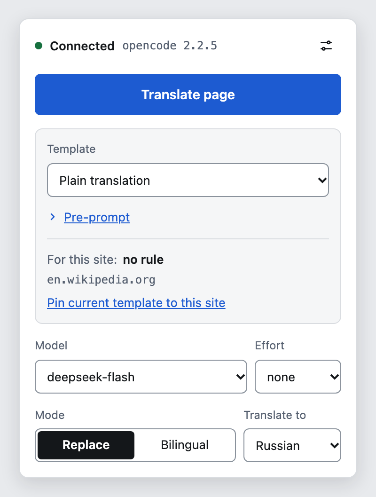
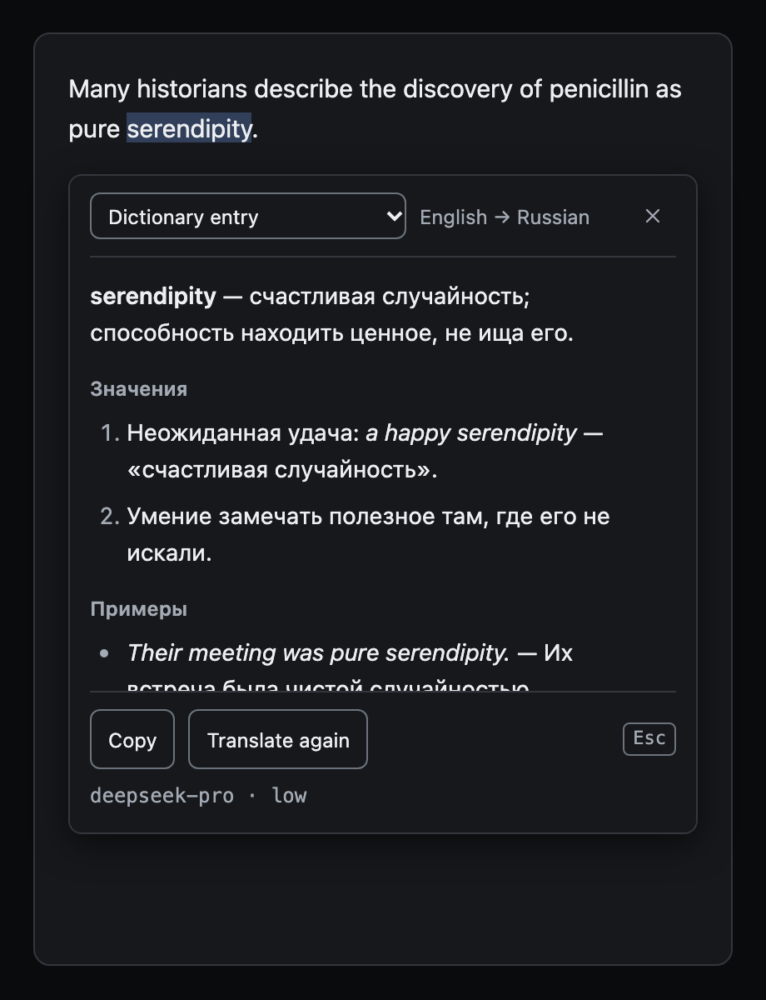
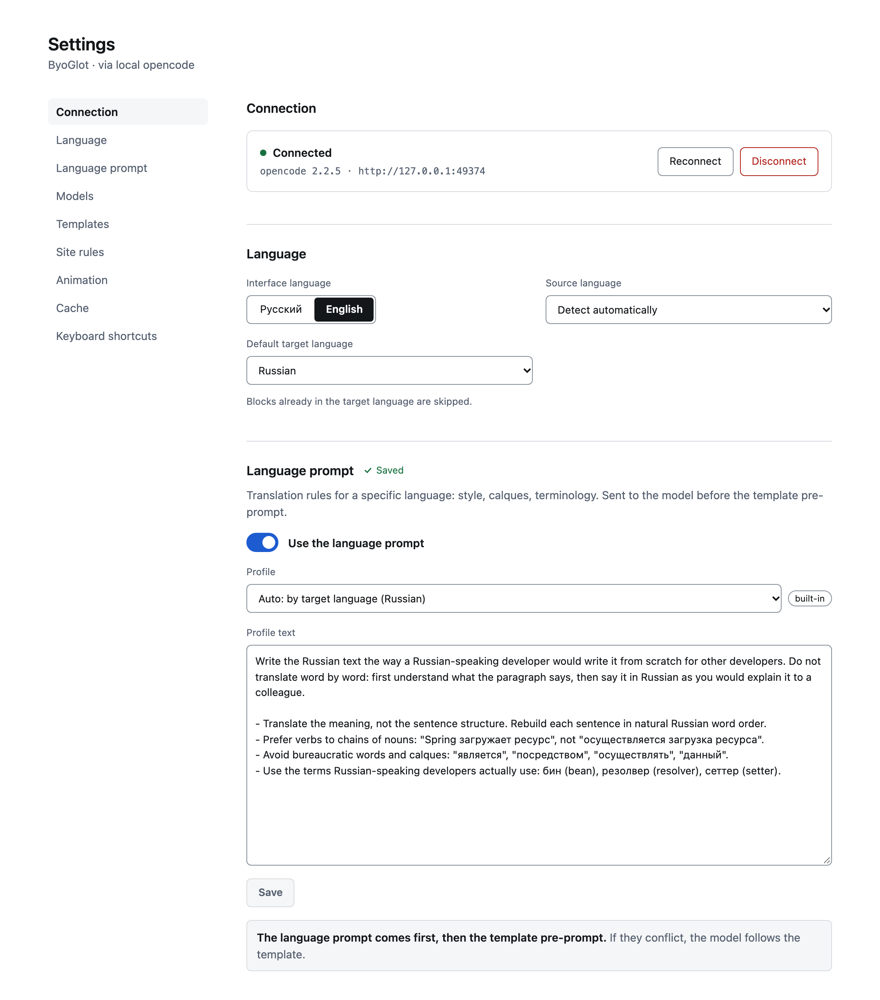

# ByoGlot Translator

English | [Русский](README.ru.md)

A Chrome and Firefox extension (Manifest V3) that translates web pages and selected text with the model you already use in [opencode](https://opencode.ai). ByoGlot stands for "bring your own" plus "-glot": the model and the translation instructions are yours. The extension has no API keys, accounts or servers of its own. It talks to opencode on your computer, and opencode calls the model provider you configured there.

MIT license. Free, no subscription, no ads, no telemetry. An independent project, not affiliated with the opencode team.

<p>
  
  
</p>



## Why

Most AI translators either lock you into their own subscription or ask for an API key per provider. If you already pay for models in opencode, this extension reuses them. You also control how the text is translated: you write the instructions yourself. Keep terms in English and add the translation in brackets, explain academic words with examples and etymology, or just translate plainly. Save those instructions as templates and bind them to sites.

## Features

- Page translation on demand, in two modes: replace the text in place, or show the translation under the original. "Show original" restores the page exactly.
- Visible text is translated first, the rest as you scroll. Content that appears later (modals, popups, infinite feeds, SPA navigation) is translated too.
- Selection translation in a movable, resizable window with two modes. One-shot translates one fragment and closes on a click elsewhere. Pinned stays open and translates every new mouse selection into a feed. Nothing is sent just because you selected something in One-shot mode.
- Templates: presets with a free-form pre-prompt, target language, display mode, and separate model and effort for pages and for selections. Applying a template copies its values to the current tab, so tweaks in the popup never change the saved template unless you save them.
- Site rules: bind a template to `example.com` or `*.example.com`.
- Any model opencode can use, with its effort level (opencode calls it a variant: `none`, `low`, `high`, `max` and so on).
- Translation cache in IndexedDB, so repeated strings and repeat visits cost nothing.
- Interface in English and Russian, light and dark themes.

## Requirements

- opencode 2.x running as a background service (`opencode service start`). opencode 1.x is not supported.
- Chrome, Edge, Brave, Arc or another Chromium browser, or Firefox, with Manifest V3.
- For development: Node.js 24 or newer and pnpm 12 (via corepack).

## Install from source

1. Clone the repository and run `pnpm install`.
2. Build: `pnpm build` for Chromium, `pnpm build:firefox` for Firefox. The output goes to `dist/`.
3. Chromium: open `chrome://extensions`, turn on developer mode, click "Load unpacked" and select `dist/chrome-mv3`.
4. Firefox: open `about:debugging#/runtime/this-firefox`, click "Load Temporary Add-on" and select `dist/firefox-mv3/manifest.json`. Temporary add-ons are removed when Firefox restarts.

After loading, reload tabs that were already open, otherwise they have no content script yet.

## Connect to opencode

A connection page opens on first install.

1. Run `opencode pair` in a terminal. It prints a one-time link like `http://127.0.0.1:<port>/auth/connect/<code>`, valid for 5 minutes.
2. Paste the link (or the whole command output) on the connection page and click "Connect".

Manual mode is for an opencode server you started yourself with a password, on another port of this computer: enter the URL (`http://127.0.0.1:<port>` or `http://localhost:<port>`), username and password. Remote servers are not supported, because the extension's host permissions cover only `127.0.0.1` and `localhost`.

For fast selection translation pick a light model with effort `none`, for example `deepseek/deepseek-flash`. Thinking (any effort above `none`) makes translation roughly 5 to 7 times slower.

## Ways to translate

The extension has three flows. They share templates, models and the cache.

### Page

Start it with the "Translate page" button in the popup or the page hotkey (Option+A on macOS, Alt+Shift+T elsewhere). The popup shows progress and has a "Stop" button. To close it, click "Show original" in the popup, which restores the page exactly.

### One-shot

Select text. A small icon appears above the end of the selection. Click it, press the selection hotkey (Option+X on macOS, Alt+Shift+S elsewhere) or use the "Translate selection" item in the context menu. A card with the translation opens next to the selection. Nothing is translated until you do one of these.

Drag the card by its header and resize it by the corner at the bottom right. It cannot leave the viewport. Close it with the cross, with Esc, or with a click outside the card. A click within 16 px around the card does not close it, so a missed drag or resize does not lose the translation. Changing the template in the header translates the selection again.

### Pinned

Click the pin button in the card header. The card stays open and the selection icon stops appearing. Every time you finish a mouse selection on the page, the extension translates it and puts the result at the top of a feed in the card. Each entry shows the original fragment, the translation, the languages and model, and a copy button. A failed entry shows its own "Retry" button. The translation that was open when you pinned the card becomes the first entry.

Selecting text inside the card does not start a translation, so you can copy part of a translation. Selecting with the keyboard does not start one either, but the hotkey and the context menu still add an entry. A template change applies to the next selections only, old entries stay as they are.

Only the cross closes a pinned card. Esc and clicks outside do nothing. Closing it cancels unfinished requests and drops the feed, nothing is saved. Click the pin button again to go back to One-shot, which keeps the top entry.

## Usage

| Action              | macOS    | Other OS    |
| ------------------- | -------- | ----------- |
| Translate selection | Option+X | Alt+Shift+S |
| Translate page      | Option+A | Alt+Shift+T |

You can also use the "Translate page" button in the popup and the "Translate selection" item in the context menu. Change the shortcuts at `chrome://extensions/shortcuts` (Chromium) or in `about:addons`, gear menu, "Manage Extension Shortcuts" (Firefox).

Shortcuts on a non-Latin keyboard layout (for example Russian) have to be checked by hand: switch the layout, press both shortcuts, and rebind them if the browser does not react.

## Pre-prompt examples

- Academic text: "Translate academic vocabulary precisely. After each term add a short explanation in brackets, an example of use and the etymology".
- Technical docs: "Keep function names, commands and file paths as they are. Keep IT terms in English and add the translation in brackets after the first use".
- Casual tone: "Translate simply and briefly, as in a message between colleagues".

## Language prompt

Before the pre-prompt of your template, the extension sends the model a set of rules for the target language: how to avoid word-for-word calques and bureaucratic phrasing, which terms developers use, how to write headings. The rules live in language profiles. The extension ships a Russian profile and a generic one, which is used for every other target language. If the pre-prompt contradicts the language prompt, the model follows the pre-prompt. The language prompt applies to page translation and to selection translation.

It is on by default. In the "Language prompt" section of the settings page you can switch it off, pick another profile or edit the text. "Reset to original" brings the built-in text back. If a new version of the extension changes a profile you edited, the settings page shows a notice and keeps your text.

Missing your language, or want to improve a profile? See [CONTRIBUTING.md](CONTRIBUTING.md#language-profiles).

## How it works

The background service worker holds the opencode address and token and is the only part that talks to opencode. It uses opencode's HTTP API: `GET /api/model` for the model list and `POST /api/experimental/generate/text` for one-shot generation without an agent session, so nothing appears in your opencode history.

The content script walks the page and collects text blocks. Inline markup (links, bold, code) is replaced with numbered placeholders such as `<x1>docs</x1>`, so the model sees whole sentences. Blocks go to the background in batches (25 blocks or 4000 characters, up to 4 requests at once). The model answers with JSON keyed by block id, and the translation is written back into the original text nodes, so links and event handlers keep working. A MutationObserver picks up new content.

The opencode endpoint is marked experimental, so all calls go through one adapter in `lib/opencode/`.

## Privacy

The text you translate (plus the page title and domain, and for selections the surrounding paragraph) goes to your local opencode and from there to the provider of the model you chose. The extension itself sends nothing anywhere else. The opencode token is stored unencrypted in the extension's `storage.local`, like in other extensions of this kind, and never reaches web pages or content scripts.

## Development

```
pnpm install
pnpm dev                     # Chromium with hot reload
pnpm dev:firefox             # Firefox
pnpm build                   # dist/chrome-mv3
pnpm build:firefox           # dist/firefox-mv3
pnpm test                    # unit tests (Vitest)
pnpm check                   # tsc, svelte-check, biome
pnpm icons                   # rebuild public/icon from docs/design/icon/svg
npx playwright install chromium
pnpm build && pnpm e2e       # e2e against a mock opencode, no network
pnpm build && pnpm e2e:live  # live test with your opencode on Wikipedia
```

`pnpm e2e:live` is never part of `pnpm e2e`. It pairs with your local opencode, translates https://wikipedia.org/wiki/Node.js with `deepseek/deepseek-flash` and has a small cost. Screenshots go to `/tmp/byoglot-live/`.

Lint the Firefox build with `npx web-ext lint --source-dir dist/firefox-mv3`.

The stack: WXT, Svelte 5, TypeScript 7 (svelte-check runs on TypeScript 6 through `.pnpmfile.cjs`, because it does not support 7 yet), Zod, idb, Vitest, Playwright, Biome. The translation quality stand that tunes the prompts lives in `tests/quality/`, see [CONTRIBUTING.md](CONTRIBUTING.md#checking-a-profile-with-the-quality-stand).

## Known limitations

- Text inside closed shadow DOM is not reachable and is not translated.
- `title`, `alt` and `placeholder` attributes are not translated yet.
- The `>_` mark in the icon is not readable at 16 px.
- Popup errors do not name the provider or HTTP status behind a limit or key error.
- The Firefox build has passed `web-ext lint` but has not been tested by hand yet.

## License

[MIT](LICENSE)
