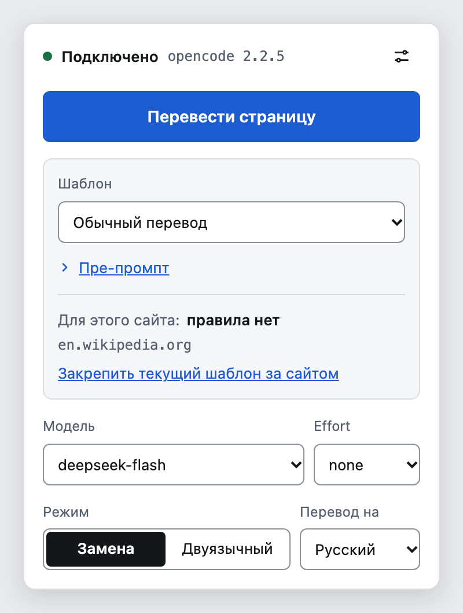
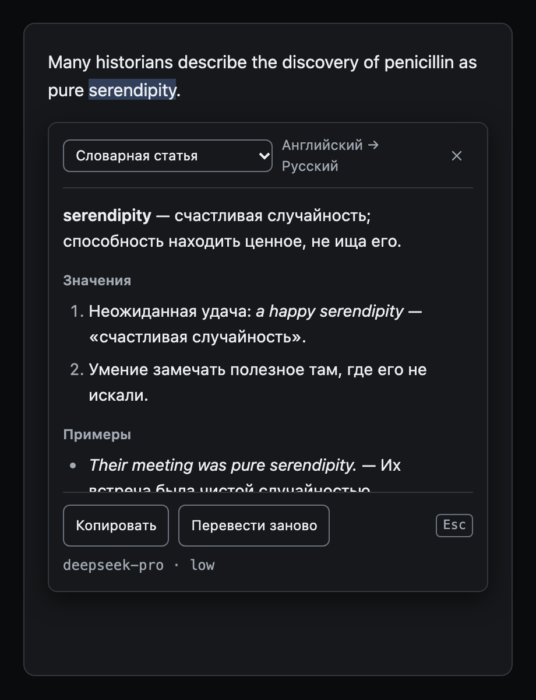
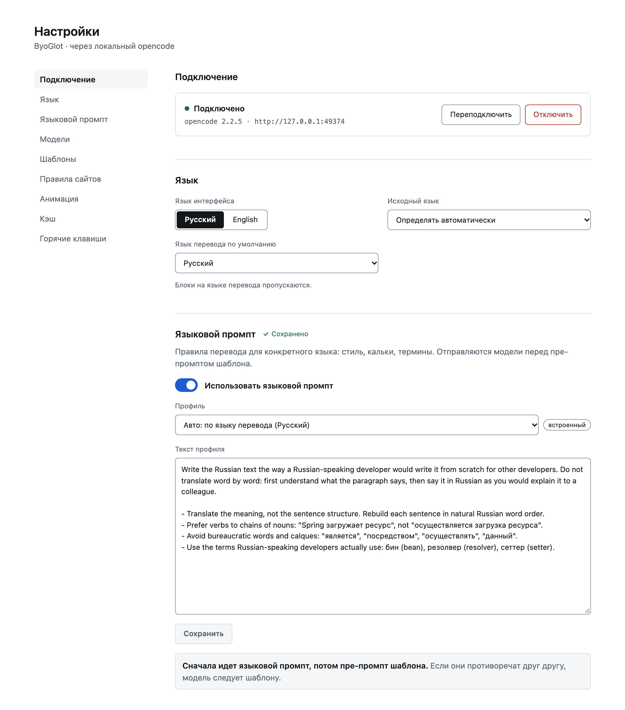

# ByoGlot Translator

[English](README.md) | Русский

Расширение для Chrome и Firefox (Manifest V3), которое переводит веб-страницы и выделенный текст через ваш локальный opencode. Ключей и аккаунтов в самом расширении нет: перевод делает модель, которую вы выбрали в opencode. ByoGlot значит "bring your own" плюс "-glot": модель и инструкции для перевода ваши.

Лицензия MIT. Бесплатно, без рекламы и телеметрии. Независимый проект, с командой opencode не связан.

<p>
  
  
</p>



## Требования

- opencode 2.x, запущенный как сервис (`opencode service start`).
- Chrome или Firefox с поддержкой Manifest V3.
- Для разработки: Node.js 24 или новее и pnpm 12 (через corepack).

## Установка из исходников

1. Склонируйте репозиторий и выполните `pnpm install`.
2. Chrome: `pnpm build`, затем откройте `chrome://extensions`, включите режим разработчика, нажмите "Загрузить распакованное расширение" и выберите `dist/chrome-mv3`.
3. Firefox: `pnpm build:firefox`, затем откройте `about:debugging#/runtime/this-firefox`, нажмите "Загрузить временное дополнение" и выберите `dist/firefox-mv3/manifest.json`.

При первой установке откроется страница подключения.

## Подключение к opencode

1. В терминале выполните `opencode pair`. Команда напечатает ссылку вида `http://127.0.0.1:<порт>/auth/connect/<код>`.
2. Вставьте ссылку на странице подключения и нажмите "Подключить". Ссылка одноразовая и живет недолго. Если она устарела, выполните `opencode pair` еще раз.
3. Ручной режим нужен, если opencode защищен паролем или запущен на другом порту этого компьютера: укажите адрес сервера (`http://127.0.0.1:<порт>` или `http://localhost:<порт>`), имя пользователя и пароль. Нелокальный адрес расширение не поддерживает: его права доступа к сайтам (host permissions) покрывают только `127.0.0.1` и `localhost`.

Токен хранится в `storage.local` расширения без шифрования, дальше фонового скрипта он не уходит.

## Как пользоваться

- Перевод страницы: кнопка "Перевести страницу" в окне расширения или горячая клавиша. Перевод начинается только по вашему действию. "Показать оригинал" возвращает страницу в исходное состояние.
- Перевод выделенного текста в окне, которое можно двигать и менять по размеру, в двух режимах. Разовый переводит один фрагмент и закрывается кликом мимо. Закрепленный остается открытым и переводит каждое новое выделение мышью в ленту. В разовом режиме выделение само ничего не отправляет.
- Режимы отображения: замена текста или двуязычный режим (оригинал и перевод рядом).

## Способы перевода

Расширение переводит тремя способами. Шаблоны, модели и кэш у них общие.

### Страница

Запуск: кнопка "Перевести страницу" в окне расширения или горячая клавиша (Option+A на macOS, Alt+Shift+T на других ОС). В окне расширения виден прогресс и есть кнопка "Остановить". Чтобы вернуть оригинал, нажмите в окне расширения "Показать оригинал": страница станет такой, какой была.

### Разовый

Выделите текст. Над концом выделения появится маленький значок. Нажмите на него, используйте горячую клавишу выделения (Option+X на macOS, Alt+Shift+S на других ОС) или пункт "Перевести выделенное" в контекстном меню. Рядом с выделением откроется карточка с переводом. Пока вы не сделали одно из этих действий, ничего не переводится.

Карточку можно двигать за шапку и менять ее размер за угол внизу справа. За границы окна браузера она не выходит. Закрыть ее можно крестиком, клавишей Esc или кликом мимо. Клик в полосе 16 пикселей вокруг карточки ее не закрывает, поэтому промах при перетаскивании или изменении размера не теряет перевод. Если выбрать другой шаблон в шапке, выделение переведется заново.

### Закрепленный

Нажмите кнопку-скрепку в шапке карточки. Карточка останется открытой, значок у выделения перестанет появляться. Каждый раз, когда вы закончили выделять текст мышью, расширение переводит его и кладет результат наверх ленты в карточке. В записи видны исходный фрагмент, перевод, языки с моделью и кнопка копирования. Если перевод не удался, в записи есть своя кнопка "Повторить". Перевод, который был открыт в момент закрепления, становится первой записью.

Выделение внутри самой карточки перевод не запускает, так что кусок перевода можно скопировать. Выделение с клавиатуры тоже не запускает перевод, но горячая клавиша и контекстное меню по-прежнему добавляют запись. Смена шаблона действует только на следующие выделения, старые записи не меняются.

Закрепленную карточку закрывает только крестик. Esc и клики мимо ничего не делают. При закрытии незаконченные запросы отменяются, а лента пропадает: ничего не сохраняется. Повторное нажатие на скрепку возвращает Разовый режим, в нем остается верхняя запись.

## Шаблоны

Шаблон задает пре-промпт (свободный текст, который отправляется модели перед каждым переводом), язык перевода, режим отображения и модели для страниц и для выделения. Встроенный шаблон "Обычный перевод" можно сбросить к исходному виду. Свои шаблоны создаются на странице настроек, в окне расширения можно временно править пре-промпт для текущей вкладки.

Примеры пре-промптов:

- Научный текст: "Переводи академическую лексику точно. После перевода термина в скобках дай короткое объяснение, пример употребления и этимологию слова".
- Техническая документация: "Не переводи имена функций, команды и пути к файлам. Термины переводи единообразно".
- Разговорный стиль: "Переводи просто и коротко, как в переписке между коллегами".

## Языковой промпт

Перед пре-промптом шаблона расширение отправляет модели правила перевода для целевого языка: как избегать калек и канцелярита, какие термины принято использовать у разработчиков, как писать заголовки. Правила хранятся в языковых профилях. В расширении есть профиль для русского и общий, он используется для всех остальных языков. Если пре-промпт шаблона противоречит языковому промпту, модель следует пре-промпту. Языковой промпт действует и на перевод страницы, и на перевод выделения.

Он включен по умолчанию. В разделе "Языковой промпт" на странице настроек его можно выключить, выбрать другой профиль или поправить текст. Кнопка "Сбросить к исходному" возвращает встроенный текст. Если новая версия расширения изменит профиль, который вы правили, страница настроек покажет уведомление и оставит ваш текст.

Нет вашего языка или хотите улучшить профиль? См. [CONTRIBUTING.md](CONTRIBUTING.md#language-profiles) (на английском).

## Правила для сайтов

В настройках можно привязать шаблон к домену: `example.com` или `*.example.com`. Побеждает более конкретное правило. Если правила нет, используется шаблон по умолчанию.

## Горячие клавиши

| Действие            | macOS    | Другие ОС   |
| ------------------- | -------- | ----------- |
| Перевести выделение | Option+X | Alt+Shift+S |
| Перевести страницу  | Option+A | Alt+Shift+T |

Изменить сочетания можно в `chrome://extensions/shortcuts` (Chrome) или в `about:addons`, меню с шестеренкой, "Управление быстрыми клавишами" (Firefox).

Ручная проверка на русской раскладке (автоматизировать нельзя): переключите раскладку на русскую, откройте страницу, нажмите сочетание для перевода страницы и для перевода выделения. Если браузер не реагирует, назначьте сочетания заново на странице управления клавишами.

## Приватность

Коротко ниже, полная политика в [PRIVACY.md](PRIVACY.md) (на английском).

Текст страницы или выделения (вместе с заголовком страницы, доменом и окружающим абзацем для выделения) отправляется на ваш локальный opencode, а оттуда провайдеру модели, которую вы выбрали. Расширение само никуда в интернет ничего не отправляет. Адрес и токен opencode лежат в `storage.local` без шифрования, кэш переводов хранится локально в IndexedDB.

## Разработка

```
pnpm install
pnpm dev            # Chrome с горячей перезагрузкой
pnpm dev:firefox    # Firefox
pnpm build          # сборка Chrome в dist/chrome-mv3
pnpm build:firefox  # сборка Firefox в dist/firefox-mv3
pnpm zip && pnpm zip:firefox  # архивы для магазинов и архив исходников для Firefox в dist/
pnpm test           # юнит-тесты (Vitest)
pnpm check          # tsc, svelte-check, biome
pnpm icons          # пересобрать public/icon из docs/design/icon/svg
npx playwright install chromium
pnpm build && pnpm e2e   # e2e с поддельным opencode, без сети
pnpm build && pnpm e2e:live   # живой тест с реальным opencode и Википедией
```

`pnpm e2e:live` не входит в `pnpm e2e`. Он подключается к локальному opencode через `opencode api POST /api/pair`, использует модель `deepseek/deepseek-flash` и стоит немного. Скриншоты сохраняются в `/tmp/byoglot-live/`.

Линт Firefox-сборки: `npx web-ext lint --source-dir dist/firefox-mv3`.

CI на каждый push и pull request запускает `check`, `test`, обе сборки, линт Firefox и e2e с поддельным opencode. Тег вида `v0.2.6` (он должен совпадать с версией в `package.json`) собирает архивы и прикладывает их к релизу на GitHub.

## Известные ограничения

- Закрытый shadow DOM (`mode: "closed"`) страница не отдает, такой текст не переводится.
- Знак `>_` на значке неразличим при размере 16 пикселей.
- Ошибка перевода страницы в окне расширения не называет провайдера, у которого сработал лимит.
- Сборка для Firefox проверена только сборкой и `web-ext lint`, ручной прогон в Firefox не делался.
